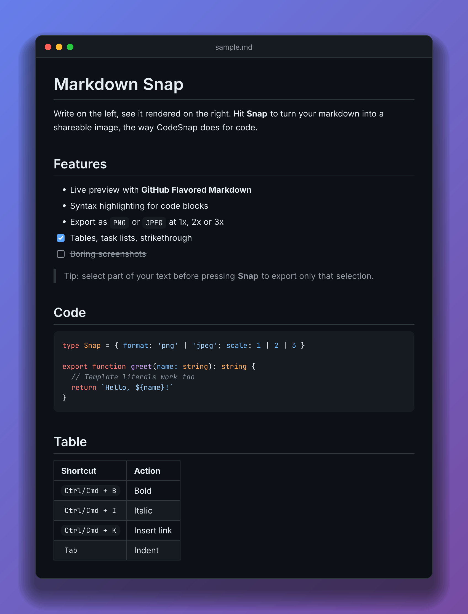
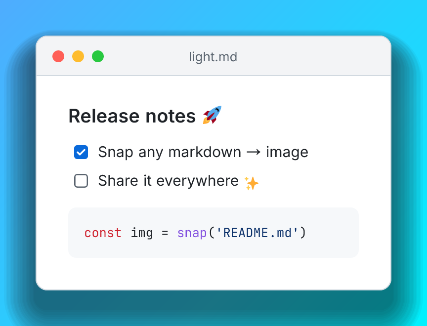
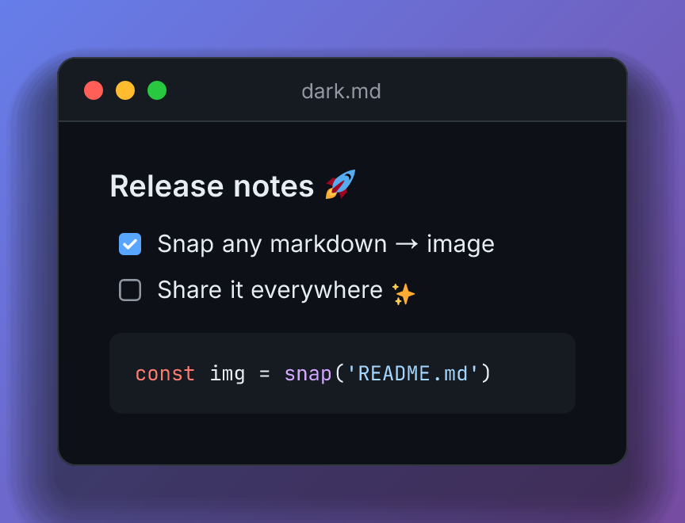
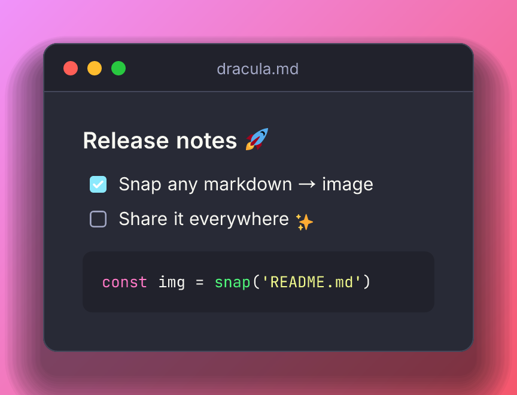
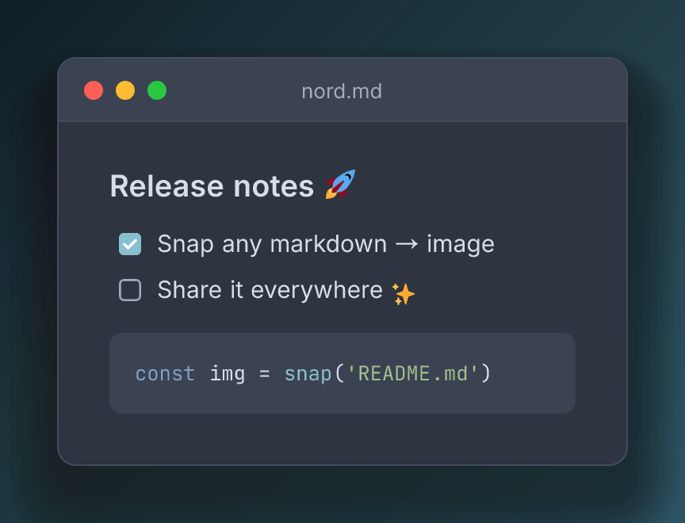
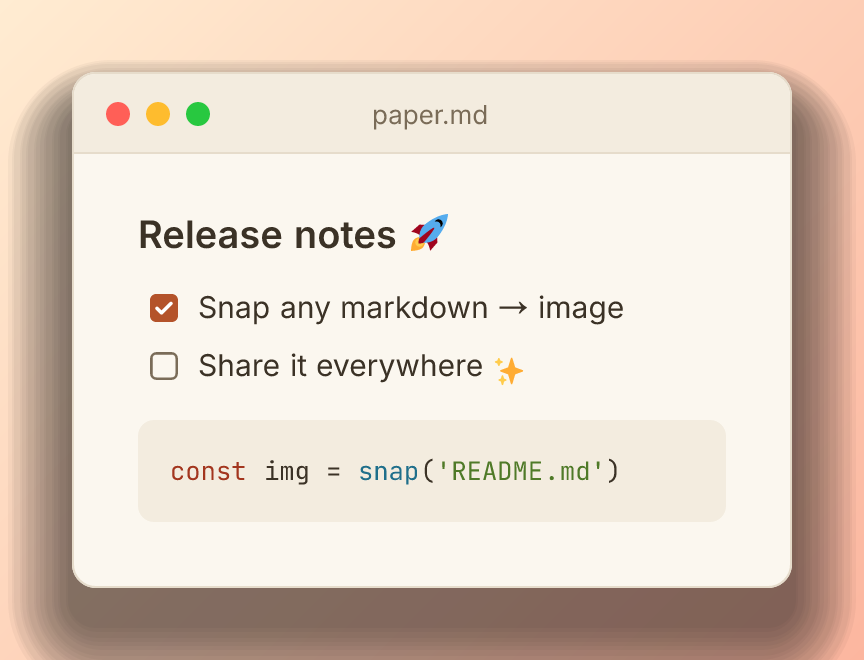
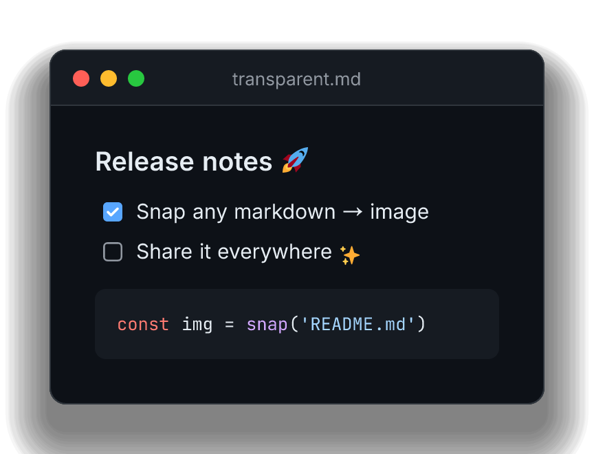
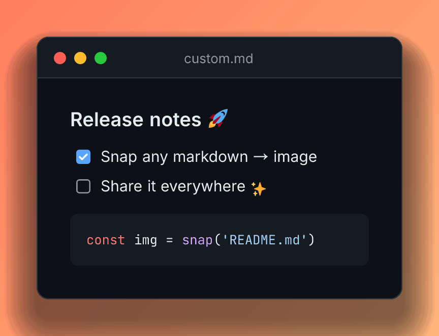
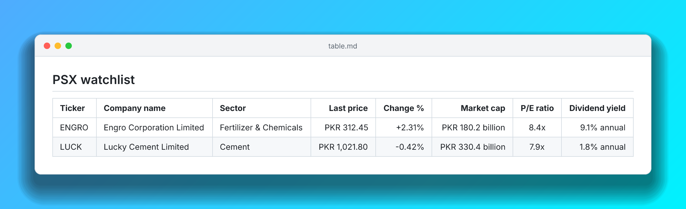
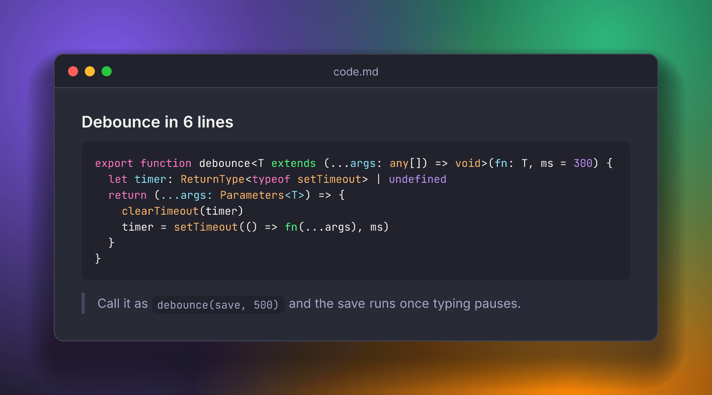

# Markdown Snap

[](LICENSE)

An agent skill that turns markdown into a polished, CodeSnap-style image. Ask
your coding agent to **"snap README.md"** or **"snap your last message"** and
get a PNG or JPEG back.

Works in **Claude Code**, and in **Codex**, **Cursor** and **GitHub Copilot**
through the open [Agent Skills](https://agentskills.io) format.



- **Nothing to set up.** No browser, no `npm install`, nothing downloaded at
  run time. You only need Node.js 18 or newer.
- **Offline and private.** The layout engine, fonts and image encoder ship
  inside the skill. Your markdown never leaves your machine.
- **Renders real markdown.** Headings, lists, task lists, quotes, syntax-highlighted
  code and GitHub tables with column alignment. A wide table widens the
  window instead of being cut off.
- **Emoji included.** All 4,000+ emoji (flags, skin tones, ✅ 🚀 🎉) are drawn
  from a bundled [Twemoji](https://github.com/jdecked/twemoji) set, so they
  look the same on every computer. Arrows and symbols like → ≈ ★ ✓ work too.
- **Remembers your look.** On your first snap you pick a background and
  theme; every snap after that uses them.

## Install

### Claude Code

```
/plugin marketplace add safwanidrees/markdown-snap-skill
/plugin install markdown-snap@markdown-snap
```

Then start a new session (or run `/reload-plugins`). The first time the skill
runs, Claude asks you to allow it once.

### Codex, Cursor, GitHub Copilot

Copy the skill folder into the folder your agent reads skills from:

```bash
git clone https://github.com/safwanidrees/markdown-snap-skill
mkdir -p ~/.agents/skills
cp -R markdown-snap-skill/plugins/markdown-snap/skills/snap ~/.agents/skills/snap
```

| Agent | Personal folder | Per-project folder |
| --- | --- | --- |
| Codex | `~/.agents/skills/snap` | `.agents/skills/snap` |
| Cursor | `~/.agents/skills/snap` or `~/.cursor/skills/snap` | `.agents/skills/snap` or `.cursor/skills/snap` |
| GitHub Copilot | `~/.copilot/skills/snap` | `.github/skills/snap` or `.agents/skills/snap` |

To update later, `git pull` and copy the folder again.

## Use

Ask in plain words:

| You say | You get |
| --- | --- |
| "snap your last message" | The agent's previous reply as an image |
| "snap README.md" | That file as an image |
| "make an image of this table, light theme" (then paste it) | Your pasted markdown as an image |
| "export CHANGELOG.md as a JPEG for Twitter" | A JPEG |
| "snap notes.md with a transparent background and open it" | A transparent PNG, opened in your image viewer |

In Claude Code you can also call it directly:
`/markdown-snap:snap notes.md --theme nord --bg ocean`

Images are saved to `~/Pictures/markdown-snaps/` (or `~/markdown-snaps/` when
there's no Pictures folder) as `<title>-<date>-<time>.png`. Snaps never
overwrite each other. Ask for another location ("save it to ./docs") or set
`MARKDOWN_SNAP_DIR`.

## Make it yours

The first time you snap, the agent asks which background and window theme you
want, and saves your answer to `~/.config/markdown-snap/config.json`.

- **Change your default:** "change my default background to ocean", "make
  light my default theme"
- **One image only:** "snap this one with a mint background". Your default
  stays as it was.
- **Start over:** "forget my snap defaults"

### Themes

| Light | Dark | Dracula | Nord | Paper |
| --- | --- | --- | --- | --- |
|  |  |  |  |  |

### Backgrounds

Pick a preset (`candy` `grape` `ocean` `mint` `sunset` `peach` `aurora`
`midnight` `slate`), remove the background, or use your own colors:

| Transparent | Your own colors |
| --- | --- |
|  |  |
| "transparent background" (`-b none`) | "orange to peach gradient" (`-b "#ff7e5f,#feb47b"`) |

One color gives a solid background (`-b "#1e1e2e"`), two or more give a
diagonal gradient, and any CSS `linear-gradient(...)` or `radial-gradient(...)`
works as written.

## Examples

| Wide table | Code |
| --- | --- |
|  |  |

The inputs are in [`examples/`](examples/).

## Command line

The skill is a plain Node.js script, so it also works without an agent:

```bash
SNAP=~/.agents/skills/snap/scripts/snap.mjs   # wherever the skill folder lives

node $SNAP README.md --theme light --open
cat notes.md | node $SNAP - -o notes.png
node $SNAP --bg ocean --theme nord --save-defaults   # set your default look
```

| Option | Values | Default |
| --- | --- | --- |
| `-t, --theme` | `light` `dark` `dracula` `nord` `paper` | `dark` |
| `-b, --bg` | a preset, `none`, a color, comma-separated colors, or a CSS gradient | `grape` |
| `-w, --width` | window width in px | `720` |
| `--padding` | space around the window in px | `64` |
| `--font-size` | base font size in px | `15` |
| `--radius` | corner radius in px | `12` |
| `--title` | window title | the file name |
| `--format` | `png` `jpeg` (also picked from `-o name.jpg`) | `png` |
| `--scale` | pixel ratio, 1 to 4 | `2` |
| `--quality` | JPEG quality, 1 to 100 | `92` |
| `-o, --out` / `--out-dir` | exact file / folder to save in | `~/Pictures/markdown-snaps` |
| `--open` | open the image when done | |
| `--no-chrome` / `--no-shadow` | hide the window bar / the shadow | |
| `--no-fit` | keep the width even when a table is wider | |
| `--last` | Claude Code only: snap Claude's previous reply | |
| `--config` / `--save-defaults` / `--reset-defaults` | show / save / clear your default look | |

Run `node $SNAP --help` for the full list.

## How it works

```
markdown ──marked──▶ tokens ──▶ Satori (flexbox layout) ──▶ SVG ──resvg──▶ PNG ──jpeg-js──▶ JPEG
```

Most "HTML to image" tools drive a headless browser. This one doesn't need a
browser: [Satori](https://github.com/vercel/satori) lays out the window and
text, [resvg](https://github.com/yisibl/resvg-js) draws it, and code is
colored by [lowlight](https://github.com/wooorm/lowlight). Everything is
bundled into one script plus WASM, font and emoji files (about 7 MB), which
is why installing the skill is just copying a folder. Emoji are placed as
small SVG images while the text is laid out, so table widths stay exact.

"Snap your last message" in Claude Code reads the reply from the session
transcript, so the text is exact rather than retyped. Claude Code's transcript
format is internal and can change, so the skill falls back to the agent passing
its reply in if reading it ever fails.

## Limits

- **Scripts:** Latin (with accents like é, ß, Ł), emoji, arrows and common
  symbols work. Other scripts such as Chinese, Hindi or Cyrillic aren't in the
  bundled fonts and show as boxes, and right-to-left text (Arabic, Urdu,
  Hebrew) comes out unjoined and reversed. The script warns in both cases.
- **Images in your markdown** show as their `[alt text]`, because the skill
  never goes online.
- **Table cells** stay on one line.
- **Other agents:** "snap your last message" works by the agent passing its
  reply in, and the first-run question is asked in chat. Sandboxed agents
  (Codex by default) can't write to `~/Pictures` or `~/.config`, so images go
  to `./snaps` in your project and your look isn't saved between sessions.

## Contributing

Bug reports and pull requests are welcome. See [CONTRIBUTING.md](CONTRIBUTING.md)
for setup, and [CHANGELOG.md](CHANGELOG.md) for what changed in each release.

## License

[MIT](LICENSE). The bundled fonts (Inter, JetBrains Mono, Noto Sans Math and
Noto Sans Symbols 2) use the SIL Open Font License
([`assets/fonts/`](plugins/markdown-snap/skills/snap/assets/fonts/)). Emoji
graphics are [Twemoji](https://github.com/jdecked/twemoji) by Twitter, Inc and
other contributors, licensed under [CC-BY 4.0](https://creativecommons.org/licenses/by/4.0/).
The bundled libraries' licenses (MIT, BSD, ISC and MPL-2.0) are listed in
[`THIRD_PARTY_LICENSES.txt`](plugins/markdown-snap/skills/snap/THIRD_PARTY_LICENSES.txt).
